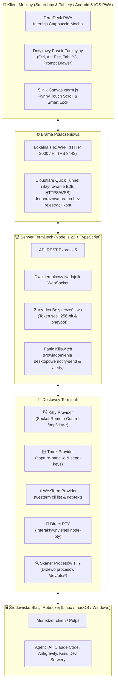

# 📱 TermDeck

<p align="center">
  <strong>Mobilne Centrum Dowodzenia & Hub Terminali PWA dla Smartfonów, Tabletów i Stacji Roboczych.</strong><br>
  <em>Podglądaj bufor na żywo i steruj sesjami Kitty, Tmux, WezTerm oraz ponad 30 agentami AI z dowolnego urządzenia mobilnego (Android / iOS) bez instalowania aplikacji ze sklepów.</em>
</p>

<p align="center">
  <a href="LICENSE"></a>
  
  
  
  
  
  <a href="https://buymeacoffee.com/adrianwulf"></a>
  <a href="https://github.com/sponsors/adrian-wulf"></a>
</p>

<p align="center">
  
  
  
  
  
  
  
</p>

---

## 📑 Spis treści
1. [⚡ Dlaczego TermDeck?](#-dlaczego-termdeck)
2. [🌐 Ekosystem Adriana Wulfa](#-ekosystem-adriana-wulfa)
3. [📊 Porównanie: TermDeck vs Tradycyjne SSH i VNC](#-porównanie-termdeck-vs-tradycyjne-ssh-i-vnc)
4. [🏗️ Architektura Systemu](#️-architektura-systemu)
5. [🚀 Szybki Start (Lokalnie & Zdalnie)](#-szybki-start-lokalnie--zdalnie)
6. [🛡️ Architektura Bezpieczeństwa & Panic Killswitch](#️-architektura-bezpieczeństwa--panic-killswitch)
7. [🤖 Obsługiwane Narzędzia AI & Multipleksery](#-obsługiwane-narzędzia-ai--multipleksery)
8. [📱 Ergonomia Mobilna & Mobilny Touch Bar](#-ergonomia-mobilna--mobilny-touch-bar)
9. [⚙️ Usługa Systemowa (systemd)](#️-usługa-systemowa-systemd)
10. [☕ Wesprzyj Projekt & Filozofia RobinHood dev](#-wesprzyj-projekt--filozofia-robinhood-dev)
11. [⚖️ Impressum & Nota Prawna (§ 5 DDG / MIT)](#️-impressum--nota-prawna--5-ddg--mit)

---

## ⚡ Dlaczego TermDeck?

Nowoczesna praca inżynierska z autonomicznymi agentami AI (Claude Code, Antigravity, Kimi Code, Codex, Aider) oraz długotrwałymi procesami kompilacji wymaga stałego podglądu stanu terminala bez konieczności ciągłego siedzenia przy biurku. Dotychczasowe rozwiązania mobilne stawiały jednak poważne bariery:

1. **Tradycyjne aplikacje SSH są ślepe**: Standardowe klienty SSH na telefon (Termius, Prompt, Blink) tworzą odizolowaną, nową sesję shella zamiast pokazywać bufor i stan procesów już uruchomionych na ekranie komputera.
2. **Pulpit zdalny (VNC / RDP) nie nadaje się na ekran dotykowy**: Przesyłanie strumienia wideo całego ekranu na telefon lub tablet oznacza nieczytelne czcionki, uciążliwą emulację kursora myszy, wysokie zużycie transferu i szybki drenaż baterii.
3. **Bariera instalacji aplikacji mobilnych**: Konieczność instalowania dedykowanego oprogramowania ze sklepów, manualnego podpisywania paczek, konfiguracji certyfikatów czy ograniczeń sideloadingu.
4. **Trudności z bezpiecznym dostępem poza siecią lokalną**: Zdalny dostęp poza domowym Wi-Fi wymagał dotąd publicznego adresu IP, przekierowywania portów na routerze, VPN lub logowania do zewnętrznych portali.

**TermDeck rozwiązuje to raz na zawsze:**
* **Natywne PWA (Zero instalacji)**: Działa bezpośrednio w Safari (iOS/iPadOS) oraz Chrome / Brave / Firefox (Android) na dowolnym smartfonie i tablecie. Zapisanie do ekranu początkowego daje pełnoekranowe doświadczenie natywnej aplikacji z obsługą bezpiecznych stref ekranu (Dynamic Island / Notche) i bez pasków przeglądarki.
* **Wieloplatformowość stacji roboczej**: Działa na systemach **Linux**, **macOS** oraz **Windows** (PowerShell, WSL2, Windows Terminal, ConEmu).
* **Bezinwazyjny Mirroring bufora w czasie rzeczywistym**: Natywne gniazda IPC w **Kitty**, **Tmux** i **WezTerm** przesyłają strumień kolorów ANSI i przyjmują komendy bez opóźnień.
* **Rejestr Agentów AI**: Automatycznie rozpoznaje ponad 30 narzędzi LLM (Claude Code, Antigravity, Kimi Code, Codex, DeepCode, JCode, Aider, Goose) oraz serwery deweloperskie z kategoryzacją i etykietami.
* **Zdalny tunel Zero-Config**: Komenda `pnpm run tunnel` automatycznie uruchamia szyfrowany tunel Cloudflare Quick Tunnel bez potrzeby rejestracji konta ani posiadania domeny. W terminalu stacji roboczej pojawia się kod QR (ANSI) gotowy do zeskanowania aparatem telefonu.
* **Wojskowy Panic Killswitch**: 256-bitowy token kryptograficzny zawarty bezpośrednio w kodzie QR. Każda próba skanowania przez boty lub 3 nieudane próby autoryzacji natychmiast **niszczą proces tunelu** i wysyłają powiadomienie na pulpit (`notify-send` oraz alerty systemowe).
* **Zaprojektowany pod ergonomię dotykową**: Wyłączony podwójny klik przybliżający ekran, płynny gest swipe po canvasie xterm, blokada wyrywania ekranu przy przeglądaniu historii, sticky `Ctrl`/`Alt` i szuflada szybkich promptów.

---

## 🌐 Ekosystem Adriana Wulfa

TermDeck jest integralną częścią niezależnego ekosystemu narzędzi programistycznych i biznesowych tworzonych zgodnie z filozofią **RobinHood dev**:

| Usługa / Projekt | Adres URL / Repozytorium | Przeznaczenie |
| :--- | :---: | :--- |
| 📱 **TermDeck** | [adrian-wulf/term-deck](https://github.com/adrian-wulf/term-deck) | **Mobilny Hub Terminali:** Centrum dowodzenia PWA dla smartfonów, tabletów i stacji roboczych (Linux, macOS, Windows). |
| ⚡ **BlitzRunner** | [adrian-wulf/blitzrunner](https://github.com/adrian-wulf/blitzrunner) | **Zero-Server CI/CD & Smart Runner:** Redukcja kosztów GitHub Actions o 85% dzięki maszynom Hetzner Cloud i filtrowi Smart Prune. |
| 🛡️ **Nachtwache** | [sentry.social-wulf.eu](https://sentry.social-wulf.eu) | **Autonomiczny Strażnik Błędów:** Drop-in zamiennik Sentry w pojedynczej binarce w Rust z AI Auto-Fix (~15 MB RAM). |
| 🚀 **Wulf Lead.er** | [lead.social-wulf.eu](https://lead.social-wulf.eu) | **B2B Lead Intelligence & OSINT Auditor:** Pozyskiwanie leadów lokalnych, audyt SEO/Core Web Vitals i analiza technologii. |
| 🌐 **Central Wulf Hub** | [social-wulf.eu](https://social-wulf.eu) | **Główny Portal Ekosystemu:** Portfolio, narzędzia biznesowe i dokumentacja techniczna Adriana Wulfa. |
| 💼 **Wulf Code** | [wulf-code.it](https://wulf-code.it) | **Software House & Consulting:** Inżynieria oprogramowania, systemy wysokiej wydajności i audyty bezpieczeństwa. |

---

## 📊 Porównanie: TermDeck vs Tradycyjne SSH i VNC

| Funkcja / Możliwość | Aplikacje Mobilne SSH | Pulpit Zdalny (VNC / RDP) | 📱 **TermDeck** (Adrian Wulf) |
| :--- | :---: | :---: | :---: |
| **Mirroring istniejących sesji terminala** | ❌ Nie (Tylko nowy shell) | ⚠️ Ociężały strumień GUI | **✅ 100% Natywny bufor ANSI** |
| **Zero instalacji na telefonie** | ❌ Wymaga aplikacji ze sklepu | ❌ Wymaga aplikacji natywnej | **✅ Natychmiastowe PWA (Safari / Chrome)** |
| **Wsparcie dla stacji roboczej** | Różnie | Różnie | **✅ Linux, macOS, Windows** |
| **Zużycie baterii i transferu mobilnego** | Niskie | Bardzo wysokie (Ciągłe wideo) | **Ultra niskie (Tekst ANSI / WebSockets)** |
| **Ergonomia ekranu dotykowego** | Zwykła klawiatura systemowa | Wirtualny kursor myszy | **Natywny Touch Bar, Sticky Ctrl/Alt** |
| **Rozpoznawanie agentów i procesów AI** | ❌ Brak | ❌ Brak | **✅ Baza 30+ narzędzi LLM z auto-detekcją** |
| **Dostęp zdalny bez przekierowania portów** | Wymaga VPN lub publicznego IP | Wymaga kont firm trzecich | **✅ 1 komenda, szyfrowany tunel OOTB** |
| **Ochrona przed intruzami** | Tylko hasło | Hasło do konta | **Token 256-bit + 3-Strike Killswitch** |
| **Wbudowany niezależny shell PTY** | Tak | Nie | **✅ Wbudowany Direct Shell / PTY** |
| **Koszt & Licencja** | Często abonamenty / freemium | Płatne licencje | **100% Darmowy kod Open Source (MIT)** |

---

## 🏗️ Architektura Systemu

TermDeck spina wieloplatformowe protokoły IPC za pośrednictwem wydajnego backendu Express 5 i WebSockets:



---

## 🚀 Szybki Start (Lokalnie & Zdalnie)

### Wymagania wstępne
* **System operacyjny hosta**: Linux (Ubuntu, Debian, Arch, Fedora itp.), macOS lub Windows (PowerShell, WSL2, Windows Terminal, ConEmu)
* **Środowisko uruchomieniowe**: Node.js 22+ oraz `pnpm` (`corepack enable pnpm`)
* **Terminal / Multiplekser**: **Kitty** (`allow_remote_control yes`), **Tmux**, **WezTerm** lub wbudowany bezpośredni shell PTY

### Instalacja
```bash
# 1. Sklonuj repozytorium
git clone https://github.com/adrian-wulf/term-deck.git
cd term-deck

# 2. Zainstaluj zależności
pnpm install

# 3. Zbuduj frontend aplikacji PWA
pnpm build
```

### Opcja A: Dostęp w sieci domowej (Wi-Fi LAN)
```bash
pnpm start
```
* Aplikacja uruchamia się pod adresem: `http://<IP_KOMPUTERA>:3000`.
* Domyślny kod PIN autoryzacji: `1337` (konfigurowany w zmiennej środowiskowej `TERMDECK_PIN`).

### Opcja B: Dostęp zdalny Zero-Config (LTE / Ogród / Podróż)
```bash
pnpm run tunnel
# lub: pnpm start --tunnel
```
* Automatycznie zestawia bezpieczny, szyfrowany Cloudflare Quick Tunnel.
* Generuje **kod QR (ANSI)** bezpośrednio w oknie konsoli komputera.
* **Zeskanuj aparatem telefonu lub tabletu**: przeglądarka otworzy się z już uwierzytelnionym 256-bitowym tokenem sesji.
* Wybierz **Udostępnij** -> **Dodaj do ekranu początkowego** (Safari / Chrome), aby uzyskać pełnoekranowe PWA.

---

## 🛡️ Architektura Bezpieczeństwa & Panic Killswitch

Ponieważ TermDeck daje pełną kontrolę nad terminalem stacji roboczej, bezpieczeństwo opiera się na zasadzie zerowego zaufania (Zero Trust):

1. **256-bitowy Token Kryptograficzny**:
   * Generowany za pomocą `crypto.randomBytes(32)` przy każdym uruchomieniu serwera.
   * Zawarty bezpośrednio w adresie kodu QR: `https://<subdomena>.trycloudflare.com/?token=<token>`.
   * Po załadowaniu na urządzeniu mobilnym token trafia do pamięci lokalnej i jest **natychmiast usuwany z paska adresu** przez `history.replaceState()`.
2. **Pułapka na automatyczne skanery (Honeypot)**:
   * Publiczne roboty sieciowe sondujące ścieżki `/.env`, `/wp-admin`, `/phpmyadmin` czy `/.git` wpadają w honeypot.
3. **Panic Killswitch (3 próby i odcięcie)**:
   * W przypadku wykrycia 3 nieautoryzowanych prób dostępu lub prób złamania PIN-u w ciągu 60 sekund:
     1. Proces tunelu jest **natychmiast bezwzględnie zamykany** (`tunnel.close()`).
     2. Dostęp do komputera z sieci publicznej zostaje całkowicie odcięty.
     3. Na monitorze stacji roboczej pojawia się krytyczne powiadomienie (`notify-send` oraz alerty desktopowe).
     4. W konsoli serwera wyświetla się czerwony baner bezpieczeństwa z adresem IP intruza.

---

## 🤖 Obsługiwane Narzędzia AI & Multipleksery

TermDeck posiada wbudowany moduł detekcji procesów powiązanych z aktywnymi oknami i panelami:

### Agenci AI & Narzędzia LLM CLI
* ✳️ **Claude Code** (`claude`, `fcc-claude`)
* 🌐 **Antigravity** (`agy`, `antigravity`, `gemini-cli`)
* 🌙 **Kimi Code** (`kimi-code`, `kimi`, `kimicode`)
* 🟢 **OpenAI Codex / ChatGPT CLI** (`codex`, `chatgpt-cli`)
* 🔷 **DeepCode** (`deepcode`)
* 🍑 **JCode** (`jcode`)
* 🦅 **Aider** (`aider`, `aider-chat`)
* 🪿 **Goose AI** (`goose`, `goose-ai`)
* 🔭 **Cline / OpenCode / OpenHands / Strix / Foundry**
* *...oraz uniwersalny mechanizm fallback dla dowolnego procesu TUI / deweloperskiego!*

### Obsługiwane silniki terminali
* **Kitty**: Komunikacja przez gniazdo `/tmp/kitty-*` z czasem odczytu bufora ~31 ms.
* **Tmux**: Automatyczne wykrywanie paneli (`tmux list-panes`), streaming ANSI (`capture-pane -e`) i przekazywanie klawiatury (`send-keys`).
* **WezTerm**: Inspekcja JSON (`wezterm cli list`) i pobieranie zawartości ekranu.
* **Direct PTY**: Niezależna, interaktywna sesja `fish` / `zsh` / `bash` / `powershell` tworzona bezpośrednio na hoście.
* **Uniwersalny Skaner TTY**: Wykrywa aktywne procesy w **Alacritty**, **Foot**, **Konsole**, **GNOME Terminal** czy **Windows Terminal** z monitorowaniem zużycia CPU i pamięci RAM.

---

## 📱 Ergonomia Mobilna & Mobilny Touch Bar

Zaprojektowany specjalnie pod kątem wygodnej obsługi jedną ręką na ekranach smartfonów i tabletów:

* **Brak uciążliwego powiększania**: Wyłączony podwójny stuk przybliżający ekran w przeglądarce.
* **Płynny Touch Scroll**: Gest przesunięcia palcem (swipe) po powierzchni canvasu xterm precyzyjnie przewija linie bufora bez szarpania.
* **Inteligentny Scroll-Lock**: Przewinięcie w górę w celu przeczytania logów lub toku myślenia modelu AI zamraża automatyczny skok do najnowszych linijek. Pływający badge **„↓ Skocz na dół (X)”** pokazuje liczbę pominiętych nowych linii.
* **Mobilny Touch Bar**:
  * Przyciski modyfikatorów `Ctrl` i `Alt` w trybie sticky (podświetlenie i łączenie z kolejnym klawiszem).
  * Klawisze nawigacji: `Esc`, `Tab`, `↑`, `↓`, `←`, `→`, `PgUp`, `PgDn`.
  * Sygnały kontrolne: `^C` (SIGINT) oraz `Enter`.
  * **Szuflada Szybkich Promptów**: Przyciski skrótowe dla komend deweloperskich (`git status`, `git diff`, `ls -la`, `clear`) oraz pole wpisywania własnych promptów z klawiatury wirtualnej.

---

## ⚙️ Usługa Systemowa (systemd)

Aby TermDeck działał nieprzerwanie w tle na stacji roboczej Linux:

```bash
# 1. Uruchom automatyczny instalator usługi
./install-service.sh

# 2. Zarządzanie usługą
systemctl --user status termdeck
systemctl --user restart termdeck
journalctl --user -u termdeck -f
```

---

## ☕ Wesprzyj Projekt & Filozofia RobinHood dev

<p align="center">
  <a href="https://buymeacoffee.com/adrianwulf"></a>
  <a href="https://github.com/sponsors/adrian-wulf"></a>
</p>

### Czym jest filozofia RobinHood dev?
> **"Wolność programisty, ergonomia pracy i suwerenność nad własną stacją roboczą powinny być dostępne natychmiast z każdego urządzenia, bez barier i zamkniętych ekosystemów."**

**TermDeck powstał w duchu RobinHood dev:**
* Zapewnienie programistom pełnej kontroli nad mocą obliczeniową ich komputerów z dowolnego urządzenia mobilnego lub przeglądarki za 0 zł.
* W 100% darmowy kod open-source na licencji MIT, bez telemetrii, bez kont i bez ukrytych opłat.

### Jak możesz pomóc?
* ☕ **Postaw kawę:** [buymeacoffee.com/adrianwulf](https://buymeacoffee.com/adrianwulf)
* 💖 **Zostań sponsorem na GitHubie:** [github.com/sponsors/adrian-wulf](https://github.com/sponsors/adrian-wulf)
* ⭐ **Dodaj gwiazdkę na GitHubie:** Pomóż projektowi dotrzeć do programistów na całym świecie.
* 🛠️ **Twórz Pull Requesty & Zgłaszaj Issues:** Wsparcie dla nowych silników terminali mile widziane!

---

## ⚖️ Impressum & Nota Prawna (§ 5 DDG / MIT)

* **Twórca / Autor:** Adrian Wulf
* **Kontakt:** Dostępny przez profil GitHub: [https://github.com/adrian-wulf](https://github.com/adrian-wulf) oraz portale [https://social-wulf.eu](https://social-wulf.eu) / [https://wulf-code.it](https://wulf-code.it).
* **Licencja:** Oprogramowanie udostępniane jest na otwartej licencji [MIT](LICENSE).

---

<p align="center">
  <em>Stworzone z pasją dla społeczności Open Source przez Adriana Wulfa.</em>
</p>
