# 📱 TermDeck

<p align="center">
  🌐 <strong>Languages:</strong>
  <a href="README.md"><strong>🇬🇧 English</strong></a> •
  <a href="README.pl.md">🇵🇱 Polski</a> •
  <a href="README.de.md">🇩🇪 Deutsch</a> •
  <a href="README.es.md">🇪🇸 Español</a> •
  <a href="README.fr.md">🇫🇷 Français</a>
</p>

<p align="center">
  <strong>Mobile Command Center & PWA Terminal Hub for iPhone & Desktop Workstations.</strong><br>
  <em>Monitor, mirror, and control active Kitty, Tmux, WezTerm sessions and 30+ AI coding agents from bed or garden with zero Apple Developer fees.</em>
</p>

<p align="center">
  <a href="LICENSE"></a>
  
  
  
  
  <a href="https://buymeacoffee.com/adrianwulf"></a>
  <a href="https://github.com/sponsors/adrian-wulf"></a>
</p>

<p align="center">
  
  
  
  
  
  
  
</p>

---

## 📑 Table of Contents
1. [⚡ Why TermDeck?](#-why-termdeck)
2. [🌐 Adrian Wulf Ecosystem](#-adrian-wulf-ecosystem)
3. [📊 Comparison: TermDeck vs Mobile SSH & VNC](#-comparison-termdeck-vs-mobile-ssh--vnc)
4. [🏗️ System Architecture](#️-system-architecture)
5. [🚀 Quick Start (Local & Remote)](#-quick-start-local--remote)
6. [🛡️ Security Architecture & Panic Killswitch](#️-security-architecture--panic-killswitch)
7. [🤖 Supported AI Agents & Terminal Multiplexers](#-supported-ai-agents--terminal-multiplexers)
8. [📱 Mobile Ergonomics & iPhone Touch Bar](#-mobile-ergonomics--iphone-touch-bar)
9. [⚙️ System Service (systemd)](#️-system-service-systemd)
10. [☕ Support the Project & RobinHood dev](#-support-the-project--robinhood-dev)
11. [⚖️ Impressum & Legal Notice (§ 5 DDG / MIT)](#️-impressum--legal-notice--5-ddg--mit)

---

## ⚡ Why TermDeck?

When moving a desktop workstation to another room (such as a bedroom) or working outside in the garden, developers running multi-agent LLM coding sessions face a frustrating dilemma:

1. **Apple's $99/year Paywall**: Deploying a custom native iOS app to your personal iPhone 16 Pro Max requires an active Apple Developer Program membership ($99/year), manual Xcode certificate provisioning, and 7-day sideloading expiration limits.
2. **Traditional Mobile SSH Apps are Blind**: Standard SSH clients (Termius, Prompt, Blink) cannot peer into windows and background tasks already running on your physical desktop. They open an isolated new shell session instead of mirroring existing running processes.
3. **VNC / RDP is Unusable on Touchscreens**: Streaming the entire 4K desktop display to an iPhone results in unreadable micro-fonts, massive bandwidth consumption, awkward mouse emulation, and rapid battery drain.
4. **Network Hassle Outside Home Wi-Fi**: Accessing your workstation from the garden or on LTE/5G typically involves complex dynamic DNS, opening hazardous router ports, or mandatory third-party accounts.

**TermDeck solves this permanently:**
* **100% Free PWA (Progressive Web App)**: Add to Home Screen in Safari with zero developer fees. Fullscreen native app feel, Dynamic Island safe-area accommodation, and zero URL bar clutter.
* **Non-Invasive Real-Time Desktop Mirroring**: Native IPC hooks into **Kitty**, **Tmux**, and **WezTerm** to stream live ANSI terminal buffers and inject inputs with zero noticeable latency.
* **AI Agent Registry**: Recognizes over 30 LLM CLI tools (Claude Code, Antigravity, Kimi Code, Codex, DeepCode, JCode, Aider, Goose) and dev servers with automatic process categorization and workspace pills.
* **Zero-Config Ephemeral Remote Tunneling**: Launch with `pnpm run tunnel` to spin up a secure, encrypted Cloudflare Quick Tunnel without creating any accounts. An ANSI QR code printed in your desktop terminal pairs your iPhone in 2 seconds.
* **Military-Grade Panic Killswitch**: 256-bit cryptographic token embedded directly in the QR code URL. Any external bot scanning or 3 failed unauthorized attempts instantly **destroys the tunnel** and triggers critical desktop notifications (`notify-send` and native `hyprctl notify`).
* **Designed for Mobile Touch**: Custom touch gestures for canvas scrolling, auto-scroll freeze when reading back-history, double-tap zoom suppression, sticky `Ctrl`/`Alt` modifiers, and a quick-prompt drawer.

---

## 🌐 Adrian Wulf Ecosystem

TermDeck is an integral part of an independent suite of developer and business tools built under the **RobinHood dev** philosophy:

| Service / Project | Live URL / Repo | Purpose |
| :--- | :---: | :--- |
| 📱 **TermDeck** | [adrian-wulf/term-deck](https://github.com/adrian-wulf/term-deck) | **Mobile Terminal Hub:** PWA command center for iPhone & desktop terminals (Kitty, Tmux, WezTerm). |
| 🛡️ **Nachtwache** | [sentry.social-wulf.eu](https://sentry.social-wulf.eu) | **Autonomous Error Tracking:** Drop-in Sentry replacement in single Rust binary with AI Auto-Fix (~15 MB RAM). |
| 🚀 **Wulf Lead.er** | [lead.social-wulf.eu](https://lead.social-wulf.eu) | **B2B Lead Intelligence & OSINT Auditor:** Local prospecting, SEO/Core Web Vitals auditing, tech stack detection. |
| 🌐 **Central Wulf Hub** | [social-wulf.eu](https://social-wulf.eu) | **Main Ecosystem Hub:** Portfolio, business tools, and technical documentation portal by Adrian Wulf. |
| 💼 **Wulf Code** | [wulf-code.it](https://wulf-code.it) | **Software House & Consulting:** Custom software engineering, high-performance systems, and security audits. |

---

## 📊 Comparison: TermDeck vs Mobile SSH & VNC

| Feature / Capability | Native iOS SSH App | VNC / AnyDesk / RDP | 📱 **TermDeck** (Adrian Wulf) |
| :--- | :---: | :---: | :---: |
| **Mirror Existing Terminal Sessions** | ❌ No (New shell only) | ⚠️ Clunky GUI stream | **✅ 100% Native ANSI Mirror** |
| **Apple Developer Account Required** | ❌ Often $99/yr for custom | ❌ Not custom | **✅ $0 (Native iOS PWA)** |
| **Resource Usage (Phone Battery & Data)** | Low | High (Constant video stream) | **Ultra Low (WebSocket Text/ANSI)** |
| **Mobile Touch Ergonomics** | Generic keyboard | Virtual mouse pointer | **Native Touch Bar, Sticky Modifiers** |
| **AI Coding Agent Awareness** | ❌ None | ❌ None | **✅ 30+ LLM Tools Auto-Detected** |
| **Remote Access Without Port Forwarding** | Requires VPN / Public IP | Requires 3rd-party accounts | **✅ 1-Command Zero-Config Tunnel** |
| **Intrusion Protection** | Password only | Account password | **256-bit Token + 3-Strike Killswitch** |
| **Integrated PTY Shell** | Yes | No | **✅ Built-in Fish / Zsh / Bash PTY** |
| **Cost & License** | $5–$20/mo or paywalled | Subscriptions | **100% Free MIT License** |

---

## 🏗️ System Architecture

TermDeck orchestrates multiple IPC protocols behind a high-performance Express 5 and WebSocket backend:

```mermaid
flowchart TD
    subgraph ClientLayer["📱 Mobile Client (iPhone 16 Pro Max / Safari PWA)"]
        PWA["TermDeck PWA\nCatppuccin Mocha UI"]
        TouchBar["Accessory Touch Bar\n(Ctrl, Alt, Esc, Tab, ^C, Prompt Drawer)"]
        XTerm["xterm.js Canvas Engine\nCustom DeltaY Touch Scroll & Smart Lock"]
    end

    subgraph NetworkLayer["🌐 Connection Gateway"]
        LAN["Local Wi-Fi (HTTP 3000 / HTTPS 3443)"]
        Tunnel["Cloudflare Quick Tunnel (E2E Encrypted HTTPS/WSS)\nZero-Config Ephemeral Gateway"]
    end

    subgraph BackendCore["💻 TermDeck Server Engine (Node.js 22 + TypeScript)"]
        Express["Express 5 REST API"]
        WSS["WebSocket Full-Duplex Broadcaster"]
        Auth["Security Manager\n(256-bit Session Token & Honeypot)"]
        Killswitch["Panic Killswitch\n(notify-send & hyprctl alerts)"]
    end

    subgraph Providers["🔌 Multi-Terminal Providers"]
        Kitty["🐱 Kitty Provider\n(/tmp/kitty-* Remote Control Socket)"]
        Tmux["🪟 Tmux Provider\n(capture-pane -e & send-keys)"]
        WezTerm["⚡ WezTerm Provider\n(wezterm cli list & get-text)"]
        DirectPTY["🐚 Direct PTY\n(node-pty Interactive Shell)"]
        SysScanner["🔍 Linux TTY Scanner\n(/dev/pts/* Foreground Process Tree)"]
    end

    subgraph DesktopWM["🖥️ Desktop Window Manager"]
        Hyprland["Hyprland (Wayland IPC / hyprctl focus)"]
        Processes["AI Agents: Claude Code, Antigravity, Kimi, Dev Servers"]
    end

    ClientLayer <--> NetworkLayer
    NetworkLayer <--> BackendCore
    BackendCore <--> Providers
    Providers <--> DesktopWM
```



---

## 🚀 Quick Start (Local & Remote)

### Prerequisites
* Linux (CachyOS, Arch, Ubuntu, Fedora) or macOS
* Node.js 22+ and `pnpm` (`corepack enable pnpm`)
* Terminal emulator: **Kitty** (`allow_remote_control yes`), **Tmux**, or **WezTerm**

### Installation
```bash
# 1. Clone repository
git clone https://github.com/adrian-wulf/term-deck.git
cd term-deck

# 2. Install dependencies
pnpm install

# 3. Build frontend bundle
pnpm build
```

### Option A: Local Network Access (LAN)
```bash
pnpm start
```
* Serves on `http://0.0.0.0:3000`.
* Default security PIN: `1337` (configurable via `TERMDECK_PIN`).

### Option B: Zero-Config Remote Access (Garden / LTE / Traveling)
```bash
pnpm run tunnel
# or: pnpm start --tunnel
```
* Spins up an ephemeral, encrypted Cloudflare Quick Tunnel automatically.
* Generates an **ANSI QR Code** directly in your desktop terminal.
* **Scan with iPhone Camera**: Safari opens with the 256-bit token pre-authenticated.
* Tap **Share** -> **Add to Home Screen** for full PWA standalone experience.

---

## 🛡️ Security Architecture & Panic Killswitch

Because TermDeck grants command execution access to your workstation, security adheres to strict zero-trust standards:

1. **256-bit Cryptographic Token**:
   * Generated with `crypto.randomBytes(32)` on each server startup.
   * Embedded directly in the QR code URL: `https://<subdomain>.trycloudflare.com/?token=<token>`.
   * On mobile boot, the token is saved into `localStorage` and **immediately purged from the browser address bar** via `history.replaceState()`.
2. **Automated Scanner Honeypot**:
   * Malicious web crawlers probing for `/.env`, `/wp-admin`, `/phpmyadmin`, or `/.git` are trapped instantly.
3. **3-Strike Panic Killswitch**:
   * If 3 unauthorized requests or failed PIN attempts occur from the public internet within 60 seconds:
     1. The Cloudflare tunnel is **immediately destroyed** (`tunnel.close()`).
     2. Public internet access to your machine is completely severed.
     3. A critical desktop notification is dispatched via `notify-send` and native `hyprctl notify`.
     4. An alert banner appears in the console with the offender's IP address.

---

## 🤖 Supported AI Agents & Terminal Multiplexers

TermDeck features a specialized process detector that maps running terminal commands to rich UI cards:

### AI Coding Agents & LLM CLIs
* ✳️ **Claude Code** (`claude`, `fcc-claude`)
* 🌐 **Antigravity** (`agy`, `antigravity`, `gemini-cli`)
* 🌙 **Kimi Code** (`kimi-code`, `kimi`, `kimicode`)
* 🟢 **OpenAI Codex / ChatGPT** (`codex`, `chatgpt-cli`)
* 🔷 **DeepCode** (`deepcode`)
* 🍑 **JCode** (`jcode`)
* 🦅 **Aider** (`aider`, `aider-chat`)
* 🪿 **Goose AI** (`goose`, `goose-ai`)
* 🔭 **Cline / OpenCode / OpenHands / Strix / Foundry**
* *...and automatic generic fallback for any custom developer binary!*

### Multi-Terminal Providers
* **Kitty**: Non-invasive `/tmp/kitty-*` socket communication with ~31ms ANSI screen retrieval.
* **Tmux**: Live pane discovery (`tmux list-panes`), full ANSI buffer streaming (`capture-pane -e`), and keyboard injection (`send-keys`).
* **WezTerm**: Native JSON CLI pane inspection (`wezterm cli list`) and escape text streaming.
* **Direct PTY**: Instant interactive `fish`/`zsh`/`bash` shell running directly on the host machine.
* **Generic Linux Scanner**: Detects TTY processes running in **Alacritty**, **Foot**, **Konsole**, or **GNOME Terminal** with live CPU/RAM metrics and Hyprland focus dispatch.

---

## 📱 Mobile Ergonomics & iPhone Touch Bar

Specially crafted for one-handed operation on **iPhone 16 Pro Max**:

* **Double-Tap Zoom Suppressed**: Prevents Safari from errantly zooming in when tapping rapid terminal inputs.
* **Smooth Touch Scrolling**: Canvas touch listener translating swipes directly into xterm buffer line offsets without jerkiness.
* **Smart Scroll-Lock**: Scrolling up to inspect compiler errors or agent reasoning automatically pauses live screen resets. A floating **"↓ Jump to Bottom (X)"** badge displays how many lines behind you are.
* **Accessory Touch Bar**:
  * Sticky `Ctrl` and `Alt` modifiers.
  * Essential navigation: `Esc`, `Tab`, `↑`, `↓`, `←`, `→`, `PgUp`, `PgDn`.
  * Emergency process break: `^C` (SIGINT) and `Enter`.
  * **Quick Commands Drawer**: Pre-configured chips for `git status`, `git diff`, `ls -la`, `clear`, and custom prompt submission.

---

## ⚙️ System Service (systemd)

To run TermDeck continuously in the background on your Linux workstation:

```bash
# 1. Run automated installer
./install-service.sh

# 2. Manage service
systemctl --user status termdeck
systemctl --user restart termdeck
journalctl --user -u termdeck -f
```

---

## ☕ Support the Project & RobinHood dev

<p align="center">
  <a href="https://buymeacoffee.com/adrianwulf"></a>
  <a href="https://github.com/sponsors/adrian-wulf"></a>
</p>

### What is the RobinHood dev philosophy?
> **"Developer freedom, ergonomic tooling, and personal workstation sovereignty should never be held hostage by $99/year corporate app store fees or clunky closed ecosystems."**

**TermDeck was built in the spirit of RobinHood dev:**
* Giving developers absolute control over their local computing power from any mobile device for $0.
* 100% Free and Open Source under the MIT license with zero telemetry, zero accounts, and zero paywalls.

### How can you help?
* ☕ **Buy Me a Coffee:** [buymeacoffee.com/adrianwulf](https://buymeacoffee.com/adrianwulf)
* 💖 **Support via GitHub Sponsors:** [github.com/sponsors/adrian-wulf](https://github.com/sponsors/adrian-wulf)
* ⭐ **Star the repository on GitHub:** Help more engineers break free from mobile constraints.
* 🛠️ **Submit Pull Requests & Issues:** Contributions and new terminal providers welcome!

---

## ⚖️ Impressum & Legal Notice (§ 5 DDG / MIT)

### Information pursuant to § 5 German Digital Services Act (DDG):
* **Developer / Publisher:** Adrian Wulf
* **Contact:** Available via GitHub: [https://github.com/adrian-wulf](https://github.com/adrian-wulf) and portal [https://social-wulf.eu](https://social-wulf.eu) / [https://wulf-code.it](https://wulf-code.it).

### Disclaimer & MIT License:
Software is provided "AS IS", without warranty of any kind, express or implied, including but not limited to warranties of merchantability or fitness for a particular purpose. See [LICENSE](LICENSE) for full details.

---

<p align="center">
  <em>Crafted with passion for the Open Source community by Adrian Wulf.</em>
</p>
